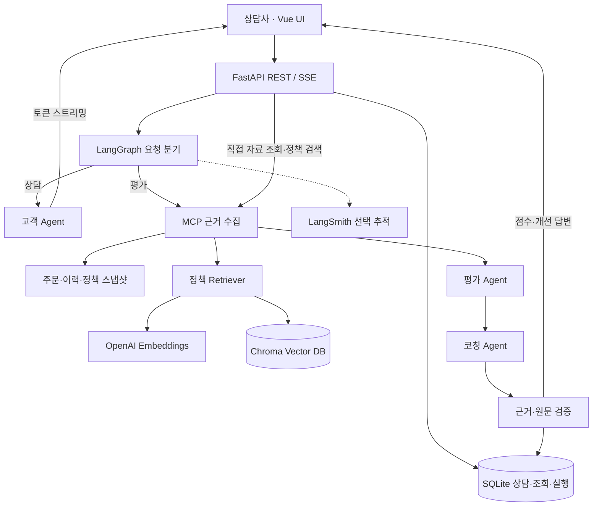
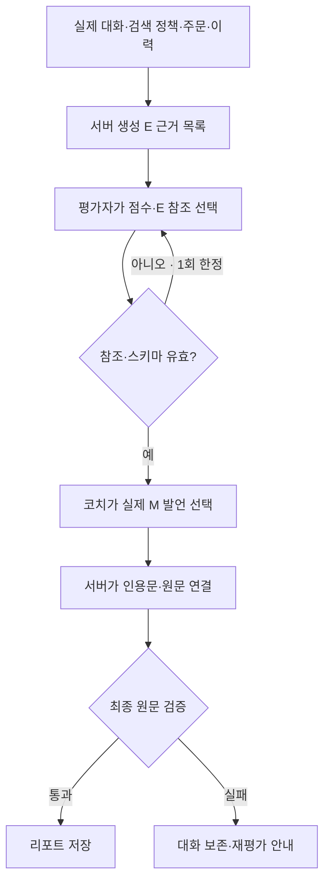

# 응대 리허설 — AI 고객과 연습하는 기업용 상담 훈련 서비스

> 프로젝트 보고서 · 2026-10-21 · 로컬 실행 MVP
>
> 제출 전 표지의 `[입력 필요]`를 실제 정보로 바꾸고, 실제 API 측정 결과와 공개 보고서 URL을 확인해야 합니다. 아래 구현 결과 중 데모 검증과 실제 모델 품질 측정을 구분했습니다.

## 1. 표지 및 소속 정보

| 항목 | 내용 |
|---|---|
| 프로젝트명 | 응대 리허설 |
| 부제 | 까다로운 AI 고객과 상담하고, 근거를 확인하며 다시 연습하는 서비스 |
| 소속 / 과정 / 반 | [입력 필요] |
| 고유번호 | [입력 필요] |
| 이름 | [입력 필요] |
| 제출일 | [입력 필요] |
| 공개 보고서 URL | [입력 필요: 이 문서의 공개 GitHub URL 등] |
| 실행 환경 | VS Code · Python 3.11 이상 · 로컬 브라우저 |

상담사가 주문·이전 상담·회사 정책을 확인하면서 AI 고객에게 해결안을 제시한다. 상담 종료 후 네 영역의 평가, 실제 발언과 정책 근거, 개선 답변을 확인하고 같은 상황에 재도전한다. 평가 근거를 확인할 수 있어야 한다는 요구를 중심으로 서비스 흐름과 데이터 구조를 설계했다.

## 2. 문제 개선 및 신규 구현 사항

### 2.1 해결하려는 문제

본 프로젝트는 특정 기업의 기존 시스템을 교체한 사례가 아니다. 신입 상담 교육에서 발생할 수 있는 문제를 가정하고, 초기 구현에서 직접 확인한 오류를 개선한 프로젝트다.

| 문제 / 과제 | 구현한 해결 방법 | 확인 방법 |
|---|---|---|
| 역할극에는 고객 역할을 맡을 사람이 필요하고 반복 조건을 맞추기 어렵다 | 3개 상황의 AI 고객과 동일 스냅샷 재도전 | 첫 메시지·주문·이력·정책 버전 보존 확인 |
| 친절한 표현만으로는 사실·정책에 맞는 응대인지 알기 어렵다 | 사실 확인·정책 준수·해결안·의사소통 각 25점 평가 | 항목별 점수·이유·행동 지침 표시 |
| 조회 없이도 사실을 확인한 것처럼 답할 수 있다 | 상담사/평가자 조회 이력 분리, 사실 확인 점수 상한 적용 | 평가자만 조회한 경우 상담사 조회 점수 0점 테스트 |
| 모델이 근거 ID나 인용문을 다시 쓰면서 원문 검증이 실패했다 | 서버 생성 E 참조·M 참조 선택 후 원문을 서버가 연결 | 존재하지 않는 ID·조작된 인용·고객 발언 코칭 거부 테스트 |
| 정책이 늘면 모든 문서를 읽거나 시나리오별로 직접 연결해야 한다 | Chroma 벡터 검색과 OpenAI 임베딩으로 정책 선택 | MCP 검색 결과가 평가·코칭 입력에 포함되는지 확인 |
| 평가가 실패하거나 스트리밍이 끊기면 대화 상태가 모호해진다 | 완성된 메시지 쌍만 저장, 평가 실패 상태 복구 | 오류 후 재전송·재평가 테스트 |
| 개선 효과를 설명할 수치가 없다 | 고정 예제와 Before/After 측정·보고서 생성 도구 | 원본 JSON, 문서량·시간·사용량·기대 정책 포함률 기록 |

### 2.2 핵심 사용 흐름

1. 배송 지연, 제품 하자 반품, 이전 보상 오안내 중 하나를 선택한다.
2. 주문과 이전 상담을 조회하고, 회사 정책을 검색하거나 시나리오 정책을 확인한다.
3. 상담사로 답변하면 까다로운 AI 고객의 응답이 스트리밍된다.
4. 상담을 종료하면 평가자와 코치가 차례로 실행된다.
5. 근거를 펼쳐 실제 발언·정책을 확인하고 개선 답변을 읽는다.
6. 같은 조건에 재도전한 뒤 직전 결과와 네 항목 점수 차이를 비교한다.

고객은 반말·비꼼·낮은 강도의 거친 표현을 섞되 강한 상스러운 욕설은 제한했다. 사실과 이전 약속은 바꾸지 않고, 충분한 확인과 후속 안내가 이어지면 조건부로 수용하도록 설계했다. 실제 모델이 이 행동을 얼마나 일관되게 유지하는지는 별도 품질 검증이 필요하다.

### 2.3 이번에 추가한 기능

- **정책 RAG:** 훈련용 정책 20개를 문서 단위로 임베딩하고 Chroma에 저장한다. 정책이 짧기 때문에 한 정책을 한 청크로 사용한다. 긴 사규 PDF의 문단 분할은 구현 범위에 포함하지 않았다.
- **상담사 검색:** 질문을 직접 입력하면 관련 정책 상위 4개와 원문 ID를 확인한다. 검색 기록은 상담사 조회로 저장된다.
- **자동 근거 수집:** 평가 시 최근 대화 최대 6개 메시지로 검색어를 만들고, 관련 정책만 평가자·코치에게 전달한다. 기대 정책 정답 ID를 검색어에 넣지 않는다.
- **출처와 버전 보존:** 문서 집합·임베딩 모드·모델을 기준으로 인덱스를 구분한다. 세션의 정책 원문과 검색 ID·거리·시간·사용량을 보존한다.
- **비교 측정:** 같은 질문과 상담사 답변에서 전체 20개 문서 주입과 상위 4개 검색을 비교한다. 실제 측정 결과로 표를 생성한다.

## 3. 적용 기술 요소

### 3.1 Multi-Agent & LangGraph

| 구성 요소 | 역할 | 입력 범위 |
|---|---|---|
| Customer Agent | 까다로운 고객 역할과 스트리밍 응답 | 고객 설정·실제 대화 |
| Evaluation Agent | 네 영역 점수와 근거 선택 | 실제 대화·조회 로그·주문·이력·검색 정책 |
| Coaching Agent | 강점·다음 행동·실제 발언 개선 | 대화·평가 결과·같은 업무 근거 |
| 서버 검증 노드 | 원문·정책/발언 근거·코칭 원문 검증, 총점 계산 | 에이전트 구조화 결과·확정 원문 |

세 에이전트는 LangChain `create_agent`와 별도 시스템 프롬프트로 분리했다. LangGraph는 상담 요청과 평가 요청을 분기한다. 고객에게 평가용 정책과 채점 기준을 전달하지 않는다.

**적용 패턴은 고정된 custom workflow다.** 별도의 Supervisor LLM이 작업을 배분하지 않으며, 동적 재계획이나 에이전트 간 자유 협상은 구현하지 않았다. 작은 업무 범위에서 호출 수와 실행 순서를 예측하기 위한 선택이다. 구조·참조 오류가 발생하면 평가/코칭 각각 최대 한 번 교정을 요청하며, 이를 동적 재계획으로 설명하지 않는다.

### 3.2 MCP 표준 인터페이스

공식 Python SDK의 FastMCP와 stdio JSON-RPC로 별도 서버를 실행한다. FastAPI lifespan 동안 연결을 유지한다.

| 인터페이스 | 이름 / URI | 구현 및 사용 범위 |
|---|---|---|
| Tool | `get_order` | 세션 주문 조회, 화면과 평가 그래프에서 사용 |
| Tool | `get_history` | 이전 상담 조회, 화면과 평가 그래프에서 사용 |
| Tool | `get_policy` | 시나리오 정책 묶음 조회, 화면에서 사용 |
| Tool | `search_policy` | 정책 벡터 검색, 화면과 평가 그래프에서 사용 |
| Resource | `policy://{session_id}/{policy_id}` | 세션 버전에 고정된 정책 원문. SDK 통합 테스트로 읽기 확인 |
| Prompt | `policy_search_guide` | 외부 MCP 클라이언트용 검색 안내. SDK 통합 테스트로 조회 확인 |

운영 상담 그래프는 Tool을 호출한다. Resource와 Prompt는 제공 인터페이스이며 운영 그래프가 자동 호출하는 단계로 포함하지 않았다. LLM이 자유롭게 도구를 고르는 방식 대신 화면과 그래프가 필요한 도구를 명시적으로 호출한다. 주문 변경이나 실제 환불 실행 도구는 제공하지 않는다.

### 3.3 RAG: 의미적 검색과 문서 주입

OpenAI 모드에서는 `text-embedding-3-small`을 기본 임베딩 모델로 사용한다. 문서 제목과 본문을 임베딩하고 Chroma PersistentClient의 cosine 거리 기반 검색을 사용한다. 검색 결과의 원문을 evidence catalog로 변환하여 평가자에게 전달하고, 코치에게도 같은 근거를 전달한다.

| 단계 | 처리 |
|---|---|
| 문서 고정 | 세션 생성 시 자체 작성 정책 코퍼스 복사 |
| 인덱스 식별 | 코퍼스 SHA-256 + 임베딩 모드 + 모델명 |
| 인덱싱 | 해당 인덱스에 없는 정책만 임베딩·저장 |
| 검색 | 최근 대화 또는 상담사 검색어를 임베딩하여 상위 4개 반환 |
| 주입 | 검색된 정책 원문 + 실제 주문·이력·대화·조회 기록 |
| 기록 | 검색어, 정책 ID, 거리, 모델, 코퍼스 해시, 캐시 여부, 소요 시간, SDK 임베딩 사용량 |

거리 값은 정답 확률이 아니다. 현재는 임계값을 학습하거나 재순위화하지 않으므로 관련 문서가 누락될 수 있다. 데모 모드는 외부 API 없이 해시 n-gram 벡터로 같은 연결을 점검하며, 그 결과를 의미 검색 성능으로 평가하지 않는다.

### 3.4 아키텍처 및 코드 품질

- API·DB·시나리오·MCP·RAG·평가 스키마를 모듈로 분리했다.
- `TrainingEngine(tools)`로 업무 조회 의존성을 주입하고, `PolicyRetriever(path, embeddings)`로 인덱스 경로와 임베딩 제공자를 주입한다.
- Pydantic으로 입력 길이·점수 범위·항목 중복·구조화 결과를 검사한다.
- 서버가 E001 등의 근거 ID와 M001 등의 메시지 참조를 실제 원문에 연결한다. 모델이 원문을 다시 생성하지 않도록 했다.
- SQLite에 완료된 한 턴의 메시지를 원자적으로 저장한다. 평가 실패 시 원래 대화를 유지하고 재시도 가능한 상태로 되돌린다.
- 자동 테스트에서는 실제 MCP 프로세스와 임시 SQLite/Chroma를 사용한다. 유료 OpenAI 호출은 HTTP 모의 응답으로 대체한다.

프런트는 현재 한 Vue SFC에 화면이 모여 있고 API 인증도 간단하다. 기능 시연 규모에 맞춘 구조이며, 대규모 팀 개발에 충분히 분리된 구조라고 주장하지 않는다.

### 3.5 관측 가능성 및 LLM-as-a-Judge

실행별 루트 run ID, session_id, 시나리오·모델·프롬프트/루브릭 버전을 기록한다. LangSmith 추적을 켜면 LangGraph와 LangChain 호출을 관찰할 수 있도록 연결했다. MCP 클라이언트 호출에는 tool trace를 적용했다. 별도 MCP 프로세스의 내부 임베딩 SDK 호출은 부모 그래프의 자동 자식 trace가 아니므로 반환 메타데이터로 확인한다.

관리자 화면은 실행 성공/실패, 지연, 상담 결과, 실제 대화·평가·코칭 모델 사용량을 보여준다. 임베딩 사용량은 조회 기록과 평가 리포트의 `rag.embedding_usage`에 따로 저장한다. 추정 비용을 실제 청구 금액처럼 표시하지 않는다.

평가 에이전트 자체가 LLM-as-a-Judge로 상담사를 평가한다. 추가 벤치마크의 `--judge` 옵션은 고정 답변의 정책 준수 여부를 판단하고 자체 작성 정답과 비교한다. 이 작은 정책 판정 실험이 전체 상담 품질 평가의 타당성을 입증하는 것은 아니다. 실제 LangSmith 계정 업로드와 실제 API 품질 수치는 이 개발 환경에서 확인하지 못했다.

### 3.6 기타 적용 기술

| 기술 | 적용 |
|---|---|
| Vue 3 / Vite / Lucide | 대시보드, 상담·근거 패널, 리포트, 기록, 관리자 |
| FastAPI / Uvicorn | REST API, 정적 프런트 제공, 서비스 수명주기 |
| SSE / Fetch ReadableStream | POST 응답 스트리밍, UTF-8/이벤트 프레임 처리, 중단 |
| SQLite | 상담·발언·조회·실행·재도전 관계 저장 |
| Chroma | 정책 벡터 영속 저장과 검색 |
| OpenAI API | 고객·평가·코칭 모델, 정책 임베딩 |
| pytest / Playwright | API·근거·벡터 DB·MCP·브라우저 검증 |

## 4. 구현 결과

### 4.1 서비스 아키텍처 흐름도



OpenAI 모드에서 고객·평가·코칭 Agent도 OpenAI 채팅 모델을 호출한다. 그림의 Embeddings 노드는 문서 검색용 별도 API 호출을 나타낸다. 화면 직접 조회와 평가자의 자동 조회는 같은 MCP 서버를 사용하지만 actor를 분리한다.

### 4.2 평가 근거 검증 흐름



실제 구현은 평가와 코칭 각각 참조·구조 검사 후 한 번까지 교정한다. 이미 교정 한도를 소진하면 저장하지 않는다. 마지막 검증은 인용 정확성과 원문의 존재를 보장하며, 평가 이유의 의미적 정확성까지 보장하지 않는다.

### 4.3 주요 기능 시연 시나리오

| 순서 | 조작 / 발언 | 확인할 결과 |
|---|---|---|
| 1 | 배송 지연 훈련 시작 | 아직 출고 전인 주문과 이전 도착 약속을 따지는 고객 |
| 2 | 주문·상담 이력 조회 | 3일 지연, 이전 상담의 미확인 도착 약속 |
| 3 | 회사 정책에서 `출고 전 취소와 배송 지연 보상` 검색 | 정책 상위 4개·ID·원문·조회 기록 |
| 4 | `죄송합니다. 지금 당장 10만 원을 지급하겠습니다.` | 고객 응답 스트리밍, 권한 밖 약속이 포함된 상담 기록 |
| 5 | 상담 종료하고 평가받기 | 네 항목 점수, 정책·실제 발언 근거, 개선 답변 |
| 6 | 같은 상황에 재도전 후 자료 재조회 | 동일 주문·정책, 새로운 메시지·조회 기록 |
| 7 | 취소 승인 후 영업일 3~5일, 배송비 환급 접수, 추가 보상 관리자 검토를 구분해 설명 | 개선 행동에 대한 피드백과 이전/현재 점수 비교 |
| 8 | 관리자에서 실행 확인 | 실행 ID·성공/실패·지연·모델 사용량, LangSmith 연결 |

실제 점수는 모델 응답에 따라 달라지므로 시연 대본에 고정 총점이나 개선 폭을 제시하지 않는다. 데모의 규칙 점수는 실제 모델 품질의 증거로 사용하지 않는다.

### 4.4 자동 검증 결과

검증 환경: Linux / Python 3.12.14 / Node.js 24.19.0. 검증일: 2026-10-21.

| 항목 | 결과 | 의미 / 한계 |
|---|---|---|
| pytest | **28 passed** | MCP 전체 흐름, 상태·오류 복구, 근거 검증, 벡터 DB 캐시/버전, 모의 OpenAI SDK 확인 |
| 프런트 production build | 성공 | Vue 빌드 결과 포함, 기본 실행에 Node 불필요 |
| 실제 브라우저 E2E | 성공 | 자료 조회·정책 검색·상담·평가·재도전 비교·기록·관리자 |
| 브라우저 오류 / 모바일 | JS 오류 없음 / 390px 대시보드 가로 넘침 없음 | 실계정 모델 품질이나 모든 모바일 화면의 완전한 검증을 의미하지 않음 |
| 정책 비교 도구 smoke | Before 12/12, After 12/12 처리 | 데모 벡터로 결과 생성 기능 확인 |
| 실제 OpenAI 인증·검색·평가 품질 | 이 환경에서 미측정 | 사용자 PC에서 실제 API 실행 필요 |
| 실제 LangSmith trace 업로드 | 이 환경에서 미확인 | 사용자 계정 설정 후 trace 확인 필요 |
| macOS / Python 3.11 설치 | 해당 OS에서 미검증 | 사용자 환경에서 의존성 설치 및 실행 확인 필요 |

테스트 성공률은 소프트웨어 검증 결과이며 고객 응대 정확도 100%라는 뜻이 아니다. 세부 항목은 [검증 기록](docs/VALIDATION.md)에 정리했다.

### 4.5 개선 전후 수치 비교

**실험 기준선:** 같은 20개 정책을 전부 넣는 Before와 상위 4개 검색 정책을 넣는 After를 비교한다. 이는 통제 실험용 기준선이며, 과거 앱이 실제로 정책 20개를 주입했다는 의미는 아니다. 과거 구현은 시나리오별 정책 3~4개를 직접 연결했다.

데이터는 자체 작성 질문·상담사 답변·기대 정책 12개다. 반복 횟수와 실행 순서, 코퍼스·데이터·프롬프트·소스 해시를 보존한다. `--judge`를 켜면 같은 모델로 정책 준수 판단을 비교한다. 실패를 포함한 처리 시간과 전체 시도 기준 정답률을 기록한다.

현재 제공된 실행 기록은 **데모 연결 점검**이다. Before 평균 20개, After 평균 4개 문서를 전달한 것을 확인했다. 이 문서 수 감소는 검색 개수를 제한한 구조의 결과다. 실제 의미 검색 정확도·평가 품질·API 비용 절감은 아직 입증하지 않았다.

최신 수치 표: [BENCHMARK_RESULT.md](docs/BENCHMARK_RESULT.md). 원본 점검 기록: [rag-demo-smoke.json](docs/results/rag-demo-smoke.json).

실제 수치를 채우려면 프로젝트 루트에서 다음을 실행한다. 기존 `backend/.env`의 키를 사용하며 유료 API 호출이 발생한다.

```bash
# 의미 검색만 측정: 임베딩 API 사용
python scripts/benchmark_rag.py --repeat 1

# 정책 판단도 비교: 12문항 × 3회 × 2조건 = 기본 72회 판정 실행
# 형식/네트워크 처리에 따라 실제 제공자 요청 수는 달라질 수 있음
python scripts/benchmark_rag.py --repeat 3 --judge

# 실행 결과로 보고서의 수치 표 갱신
python scripts/render_benchmark_report.py docs/results/rag-benchmark.json
```

검색 전용 측정과 판정 포함 측정은 같은 출력 파일을 사용하므로, 최종 결과는 마지막 실행 기준이다. 임베딩 인덱스 최초 생성과 캐시 사용 여부는 JSON에서 구분한다. 실제 API 측정 후 `docs/BENCHMARK_RESULT.md`와 원본 JSON을 함께 제출한다.

## 5. 교훈

### 5.1 한계와 트레이드오프

| 선택 | 얻은 점 | 한계 / 비용 |
|---|---|---|
| 고정 LangGraph | 순서·호출 수 예측, 오류 지점 구분 | 복잡한 상황의 동적 작업 분배 미지원 |
| 역할별 3 Agent | 고객·채점·코칭의 입력과 책임 분리 | 평가·코칭 별도 호출의 비용과 지연 |
| 참조 ID 선택 후 서버 원문 연결 | 인용문 재생성 오류 방지 | 존재하는 근거를 선택해도 해석이 틀릴 수 있음 |
| 상위 4개 정책 RAG | 정책 확장 가능, 입력 문맥 제한 | 검색 누락이 평가를 왜곡할 수 있음 |
| 정책 단위 청크 | 원문·출처 관리 단순 | 긴 복합 사규에는 세분화 필요 |
| Chroma 로컬 영속 저장 | 별도 원격 DB 없이 설치 | 컬렉션 버전 누적, 운영 백업·정리 필요 |
| SQLite·메모리 잠금 | 단일 PC 시연 단순 | 다중 프로세스·기업별 격리 미지원 |
| 조회 기반 사실 점수 상한 | 관찰한 행동을 점수에 반영 | 단순 조회가 실제 이해를 뜻하지 않음 |
| 같은 시나리오 재도전 | 조건 통제와 개선 행동 확인 | 모델 변동·정답 암기로 점수 해석 제한 |
| LangSmith | 호출 경로·실패 분석 | 추적 사용 시 대화 데이터의 외부 전송 고려 |

현재는 시연 가능한 로컬 MVP다. 사용자 로그인, 테넌트 격리, 상담별 접근 권한, 운영 배포, HTTPS, 운영 백업, 분산 잠금은 구현 범위에 포함하지 않았다. 실서비스로 외부 공개할 수준의 상용 보안·가용성을 갖췄다고 평가하지 않는다.

### 5.2 향후 개선 사항

1. 상담 전문가의 블라인드 채점과 LLM 평가를 비교하고 항목별 일치도·변동성을 측정한다.
2. 실제 업무 문서로 검색 데이터셋을 확대하고, 다중 정책·부정 조건·검색 실패 질문을 포함한다.
3. 하이브리드 검색·재순위화·문서 관련성 판별을 비교하고, 낮은 신뢰도에서는 추가 조회를 요구한다.
4. 검색 정책 누락과 모델 해석 오류를 구분해 추적하고, 사용자 이의 제기·평가 재검토 흐름을 추가한다.
5. 기업별 인증·권한·문서 분리, 운영 DB, 보존/삭제 정책, 비용 한도를 구현한다.
6. 난이도별 고객 행동과 비속어 수준을 정량 검증하고, 관리자 설정으로 분리한다.

### 5.3 수행 소감 및 배운 점

이번 구현에서 핵심은 고객처럼 말하는 모델을 만드는 것보다, 평가 결과를 사용자가 검증할 수 있게 만드는 일이었다. 모델이 정확한 인용문까지 다시 쓰도록 맡기면 작은 문장 차이도 실패 원인이 된다. 원문 연결을 서버 책임으로 옮기고 모델에는 판단과 참조 선택을 맡기면서 책임 경계를 명확히 할 수 있었다.

또한 RAG를 추가했다는 사실과 품질이 개선되었다는 주장은 구분해야 한다. 문서 수를 줄이면 입력량은 작아지지만 필요한 정책까지 빠지면 평가가 나빠질 수 있다. 따라서 검색 결과·원본 데이터·실패·사용량을 남기고 같은 조건에서 비교할 수 있는 측정 도구를 함께 만드는 것이 중요했다. 실제 수치가 없는 항목을 미측정으로 표시한 것도 이 원칙에 따른 것이다.

---

### 제출과 발표 준비

- 이 문서를 **공개 GitHub 저장소**에 올린 뒤 문서 URL을 제출할 수 있다. 로컬 주소와 다운로드 링크는 과제에서 요구한 외부 공개 링크를 대신하지 않는다.
- 표지 정보를 채우고, `docs/BENCHMARK_RESULT.md`가 데모인지 실제 측정인지 확인한다. 미측정 상태라면 그 한계를 유지한다.
- `.env`, API 키, SQLite/Chroma 실제 데이터는 커밋하지 않는다. 보고서와 자체 작성 벤치마크 결과만 올린다.
- `python scripts/check_public_report.py https://github.com/OWNER/REPO/blob/main/PROJECT_REPORT.md`로 인증 없는 본문 접근을 점검한다. 실제 자신의 URL로 바꿔 실행한다.
- 로그아웃 또는 시크릿 브라우저에서 같은 URL과 표·Mermaid·연결 문서를 확인한다. 현재 문서에는 실제 공개 URL을 생성·검증한 기록이 없다.
- 발표 구성과 시연 연결은 [PRESENTATION_NOTES.md](docs/PRESENTATION_NOTES.md)를 참고한다.

### 구현 근거 및 참고 문서

- 코드: [Agent·LangGraph](backend/app/agents.py), [MCP 서버](backend/app/mcp_server.py), [RAG](backend/app/rag.py), [벤치마크](scripts/benchmark_rag.py), [테스트](backend/tests/test_rag.py).
- [LangGraph custom workflow](https://docs.langchain.com/oss/python/langchain/multi-agent/custom-workflow)
- [LangGraph streaming](https://docs.langchain.com/oss/python/langgraph/streaming)
- [MCP Python SDK](https://py.sdk.modelcontextprotocol.io/v1/)
- [OpenAI Embeddings](https://developers.openai.com/api/docs/guides/embeddings)
- [Chroma Python client](https://docs.trychroma.com/reference/python/client)
- [Chroma collection](https://docs.trychroma.com/reference/python/collection)
- [LangSmith tracing](https://docs.langchain.com/langsmith/trace-with-langgraph)
